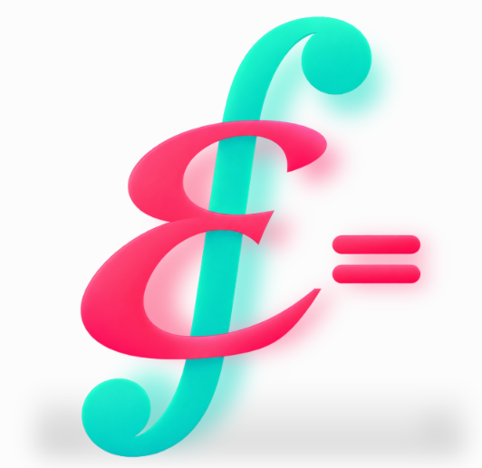

# Equa

Aplicación para Android que permite seleccionar y resolver cuatro cálculos mediante formularios dinámicos.

## Tabla de contenidos

- [Descripción](#descripción)
- [Funcionalidades](#funcionalidades)
- [Ejecución](#ejecución)
- [Licencia](#licencia)
- [Contacto](#contacto)

## Descripción

**Equa** es mi Ejercicio 1 - Android desarrollado con vistas en **XML**. Desde un menú principal se puede acceder a cuatro formularios mediante navegación entre **Activities**.

## Funcionalidades

- **Índice de masa corporal (IMC):** calcula el índice a partir del peso y la estatura y muestra su clasificación orientativa para adultos.
- **Ley de Ohm:** calcula la corriente a partir del voltaje y la resistencia.
- **Distancia recorrida:** calcula la distancia a partir de la velocidad constante y el tiempo.
- **Interés compuesto:** calcula el capital final y el interés ganado a partir del capital inicial, la tasa de interés y los periodos.

Los formularios incluyen validación de entradas del usuario, así como mensajes de error con datos inválidos, y opción para **Calcular**, **Limpiar** y **Volver**, así como una imagen de la fórmula utilizada. La aplicación ofrece textos en **español e inglés**.

La única **implementación extra** es **Navegación entre vistas**, para esto empleé el método: 
- **`finish()`:** cierra la Activity actual, se usa en **Volver**, para regresar a la pantalla anterior sin abrir otra instancia del menú. Intent y startActivity() se utilizan para avanzar entre pantallas como lo visto en el Taller.

## Ejecución

1. Abrir el proyecto en **Android Studio**.
2. Esperar a que finalice la sincronización de **Gradle**.
3. Seleccionar un emulador o dispositivo con Android 9 (API 28) o superior.
4. Ejecutar la aplicación desde Android Studio.
5. Al presionar una de las 4 fórmulas se redigirá al formulario correspondiente, presionar Volver para ir al menú o Limpiar para un nuevo cálculo

## Licencia

Distribuido bajo la Licencia MIT.

## Contacto

- **Nombre:** Alison Becerra Lara
- **Correo:** alisonblara@gmail.com
- **Enlace del proyecto:** https://github.com/AlisonBL/equa
